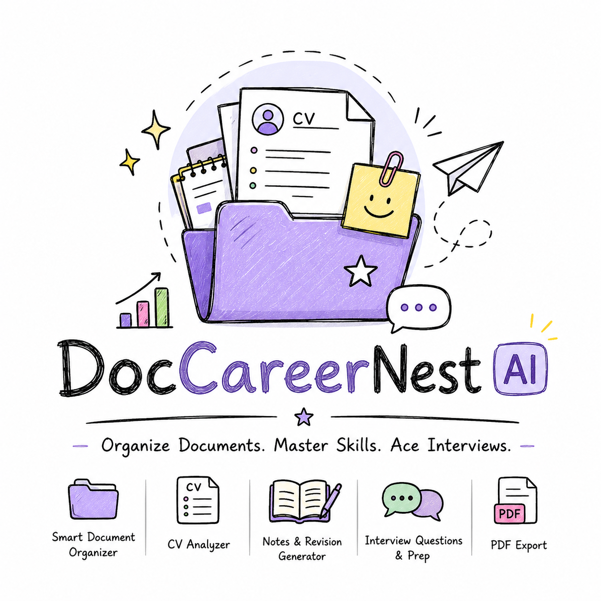

# 📚 DocCareerNest AI
### Your Intelligent Workspace for Documents, Career Growth & AI-Powered Productivity

<p align="center">
  <strong>Organize smarter. Understand documents faster. Build your career with AI.</strong>
</p>

<p align="center">
  
</p>

<p align="center">
  
  
  
  
  
  
</p>

---

## 🌟 Overview

**DocCareerNest AI** is an AI-powered document management and career productivity application designed to bring document organization, document intelligence, and career-focused tools together in one workspace.

The project aims to help users organize files, discover documents, identify duplicate files, work with career-related documents, and access intelligent assistance through a unified interface.

Unlike a traditional document organizer, DocCareerNest AI is being developed with a broader vision: combining **File Intelligence, Agentic AI, workflow automation, and CV Intelligence** into one extensible platform.

The application currently includes a React-based frontend and a FastAPI backend, with file indexing, metadata extraction, SHA-256 hashing, duplicate detection, and automated tests forming part of its existing foundation.

> **Project vision:** Build a practical, intelligent workspace that makes document management and career preparation more organized, accessible, and efficient.

## ✨ Key Features

### 📁 1. Intelligent File Explorer

A document discovery and organization foundation designed to help users locate and understand their files.

- Scan user-approved directories.
- Index file metadata.
- Search indexed files.
- Retrieve recently modified files.
- Identify exact duplicate files using content hashing.
- Maintain an index of discovered files.
- Keep file discovery within explicitly approved scan locations.

**Current foundation:** File scanning, metadata processing, hashing, duplicate detection, and related API endpoints are implemented.

### 🤖 2. AI Assistant

A dedicated assistant interface intended to make document-related tasks easier.

- Assistant interface within the main workspace.
- Foundation for document-related queries.
- A starting point for future intelligent tool execution.
- Designed for future integration with backend services and AI workflows.

**Development note:** The current assistant uses frontend keyword-based response logic. A fully implemented LLM-powered agent with backend query orchestration is part of the future development work.

### 📄 3. CV-to-Notes

A career-document workspace intended to support working with CVs and related notes.

- Dedicated CV-to-Notes interface.
- Workspace integration for CV and note-related data.
- Foundation for future AI-assisted document processing.

**Development note:** Complete backend-powered CV analysis and automated note generation are not yet implemented.

### 📊 4. Resume Analyzer

A dedicated interface for the future development of intelligent resume analysis.

The planned direction includes helping users understand their resumes, identify improvement opportunities, and organize career-related information.

### 🎯 5. Interview Preparation

A dedicated workspace for interview preparation.

The long-term goal is to support structured interview practice and career preparation through intelligent, career-focused tools.

### 🧠 6. Mind Maps & Graphs

Visual workspace interfaces designed to support structured information and graphical exploration.

- Mind Maps
- Graphs
- Dedicated navigation and page layouts

Further interactive and AI-powered capabilities can be developed on top of these interfaces.

### ⚙️ 7. Settings & Preferences

A centralized settings workspace containing:

- Profile interface
- Preferences
- Notifications
- Security interface
- Storage management

Some preferences and storage operations are functional, while account management, authentication, and several security features still require backend implementation.

### 🔄 8. Workflow Automation with n8n

**Planned core capability**

The project is intended to integrate n8n for workflow automation, connecting document-related events and future AI services to automated processes.

Potential use cases include:

- Document-processing workflows
- Automated career-document pipelines
- Integration between application services
- Event-driven background tasks

The n8n integration is not yet implemented in the current application.

---

## 🛠️ Technology Stack

### Frontend

| Technology | Purpose |
|---|---|
| React 19 | Component-based user interface |
| Vite 6 | Development server and production build |
| Tailwind CSS 3 | Utility-first styling |
| React Router DOM 7 | Client-side navigation |
| Lucide React | Interface icons |
| Recharts | Data visualization |
| JavaScript / JSX | Frontend development |

### Backend

| Technology | Purpose |
|---|---|
| Python | Backend application logic |
| FastAPI | REST API framework |
| SQLite | Local application database |
| Pydantic | Data validation and schemas |
| SHA-256 | File-content hashing |
| Pytest | Automated backend testing |

### Development Tools

- Visual Studio Code
- Git and GitHub
- npm
- Python virtual environments
- REST API testing
- n8n — planned integration

---

## 🏗️ Project Architecture

The application follows a frontend/backend structure.

```text
DocCareerNest-AI/
│
├── frontend/
│   ├── src/
│   │   ├── components/
│   │   ├── data/
│   │   ├── hooks/
│   │   ├── layouts/
│   │   ├── pages/
│   │   └── styles/
│   ├── package.json
│   └── package-lock.json
│
├── backend/
│   ├── app/
│   │   ├── agents/
│   │   ├── api/
│   │   ├── core/
│   │   ├── db/
│   │   ├── schemas/
│   │   └── services/
│   ├── tests/
│   ├── data/
│   ├── README.md
│   └── pytest.ini
│
├── docs/
├── n8n-workflows/
├── .gitignore
├── FRONTEND_TECHNICAL_DOCUMENTATION.md
└── README.md
```

### Frontend Responsibilities

The frontend provides the user interface, navigation, workspace state, document-related screens, and communication with supported backend endpoints.

### Backend Responsibilities

The backend provides REST APIs and the foundation for file indexing, metadata processing, hashing, duplicate detection, and approved-directory management.

### Integration Approach

The frontend communicates with supported backend endpoints through a centralized API utility.

The default API base URL is:

```text
http://127.0.0.1:8000/api
```

The URL can be configured using the `VITE_API_BASE_URL` environment variable.

**Architecture note:** Some frontend pages still use browser-side files or in-memory workspace state instead of the backend's persistent file index. Complete integration remains part of the development roadmap.

---

## 🚀 Getting Started

Follow these instructions to run the project locally on Windows.

### Prerequisites

Install the following tools:

- [Node.js](https://nodejs.org/)
- [Python](https://www.python.org/)
- [Git](https://git-scm.com/)
- [Visual Studio Code](https://code.visualstudio.com/)

### 1. Clone the Repository

```bash
git clone https://github.com/Asiiifa/Doccareernest-project.git
```

Navigate to the project directory:

```bash
cd Doccareernest-project
```

> The repository currently contains the `master` branch. If necessary, switch to it using `git switch master`.

### 2. Set Up the Frontend

Navigate to the frontend directory:

```bash
cd frontend
```

Install the dependencies:

```bash
npm install
```

Start the development server:

```bash
npm run dev
```

Vite will display the local development URL in your terminal. Open that URL in your browser.

To generate a production build:

```bash
npm run build
```

To preview the production build locally:

```bash
npm run preview
```

### 3. Set Up the Backend

Open a second terminal at the project root.

Navigate to the backend directory:

```powershell
cd backend
```

Create a Python virtual environment if you do not already have one:

```powershell
python -m venv venv
```

Activate it:

```powershell
.\venv\Scripts\Activate.ps1
```

Install the backend dependencies.

If a dependency file such as `requirements.txt` is present in your local backend directory, use:

```powershell
pip install -r requirements.txt
```

If no dependency file exists, install the packages listed in the backend imports and project configuration. Do not assume that an empty or incomplete dependency file contains everything required.

Start the FastAPI development server using the application's configured entry point:

```powershell
uvicorn app.main:app --reload
```

The backend should start on its configured local address, commonly:

```text
http://127.0.0.1:8000
```

If the application uses a different port or configuration, follow the values defined in the backend settings.

### 4. Access the API Documentation

When the backend is running, open:

```text
http://127.0.0.1:8000/docs
```

FastAPI provides interactive API documentation at this endpoint when enabled.

---

## 🔌 Available Backend API Endpoints

The following endpoints are implemented in the current backend foundation.

| Method | Endpoint | Purpose |
|---|---|---|
| GET | `/api/health` | Health check |
| POST | `/api/files/approved-roots` | Register an approved scan root |
| GET | `/api/files/approved-roots` | Retrieve approved scan roots |
| POST | `/api/files/scan` | Scan an approved directory |
| POST | `/api/files/search` | Search indexed files |
| GET | `/api/files/latest` | Retrieve recently modified indexed files |
| POST | `/api/files/duplicates` | Identify exact duplicate files |
| GET | `/api/files/{id}` | Retrieve an indexed file by ID |

**Important:** The availability of an endpoint does not imply that every frontend page is fully integrated with it. Authentication, authorization, and production security hardening must be addressed before public deployment.

---

## 🧪 Testing

The backend includes automated tests covering APIs and core file-processing functionality.

Run the test suite from the `backend/` directory:

```powershell
.\venv\Scripts\python.exe -m pytest
```

### Latest Verification

The development environment was verified with the following results:

| Verification | Result |
|---|---|
| Frontend production build | Successful |
| Frontend modules transformed | 743 |
| Backend automated tests | 22 passed |
| Backend test failures | 0 |
| Frontend bundle-size warning | Present |
| Starlette deprecation warning | Present |

These results reflect the latest recorded local checks and may change as the code evolves.

Passing automated tests does not guarantee that every screen, API integration, or production deployment scenario has been tested.

---

## 🔐 Security & Privacy

Security is an important consideration for a document-management application.

The current development foundation includes approved scan roots and local file indexing. Further security work is necessary before production deployment.

Recommended safeguards include:

- Scan only explicitly approved directories.
- Validate and restrict filesystem paths.
- Prevent access to unauthorized system locations.
- Keep API keys and credentials out of source control.
- Exclude virtual environments, caches, and local databases from Git when appropriate.
- Add authentication and authorization before exposing private document APIs publicly.
- Apply request validation, logging, and error handling.
- Review file-handling behavior and sensitive metadata.
- Back up important local data before making structural changes.

**Never commit real API keys, passwords, access tokens, or private credentials to a public repository.**

---

## 🗺️ Development Roadmap

DocCareerNest AI is actively being developed. The roadmap focuses on turning the current functional foundation into a more integrated intelligent workspace.

### Phase 1 — File Intelligence

- [x] File scanning foundation
- [x] Metadata extraction
- [x] SHA-256 hashing
- [x] Exact duplicate detection
- [x] Approved scan-root management
- [x] Backend automated tests
- [ ] Harden filesystem path validation
- [ ] Add root removal functionality
- [ ] Complete frontend integration with the persistent file index

### Phase 2 — Agentic AI

- [x] Initial file-agent foundation
- [x] Assistant interface
- [ ] Implement a backend agent-query API
- [ ] Integrate an LLM where appropriate
- [ ] Implement reliable tool selection and execution
- [ ] Add permission-aware document operations
- [ ] Introduce clear execution status and error handling

### Phase 3 — n8n Automation

- [ ] Connect n8n to the application
- [ ] Create and test workflow definitions
- [ ] Integrate supported webhook events
- [ ] Add reliable execution tracking and error handling

### Phase 4 — CV Intelligence

- [x] CV-to-Notes interface foundation
- [x] Resume Analyzer interface foundation
- [ ] Implement backend CV analysis
- [ ] Add structured resume extraction
- [ ] Generate useful career-focused insights
- [ ] Connect analysis results to the frontend

### Phase 5 — Production Readiness

- [ ] Complete frontend/backend integration
- [ ] Implement authentication and authorization
- [ ] Improve error handling and observability
- [ ] Optimize frontend bundle size
- [ ] Expand automated test coverage
- [ ] Validate deployment configuration
- [ ] Prepare a secure mobile-release strategy

---

## 🎯 Project Goals

DocCareerNest AI aims to bring several related capabilities into one application:

- **Document Intelligence:** Find, index, and understand files.
- **Agentic AI:** Enable useful, permission-aware actions through intelligent tools.
- **CV Intelligence:** Make career-document workflows more useful.
- **Workflow Automation:** Connect services and automate repetitive tasks.
- **Career Productivity:** Provide a central workspace for resume-related tasks and interview preparation.

The goal is to build these capabilities incrementally, with a focus on reliability, practical usefulness, and a clear separation between the frontend and backend.

---

## 🤝 Contributing

Contributions, suggestions, and constructive feedback are welcome.

If you want to contribute:

1. Fork the repository.
2. Create a feature branch.
3. Make a focused change.
4. Run the relevant tests.
5. Submit a pull request describing the change.

Please avoid committing credentials, private documents, local databases, or virtual environments.

---

## 📌 Current Project Status

DocCareerNest AI is a work in progress.

The frontend production build currently succeeds, and the backend test suite has passed 22 tests in the latest recorded verification. Several planned capabilities—including full Agentic AI, n8n automation, complete CV intelligence, and broader frontend/backend integration—remain under development.

The repository is intended to evolve as these features are implemented and tested.

---

## 👩‍💻 Author

**Asifa Hamid Khan**

Developer of DocCareerNest AI.

---

<p align="center">
  <strong>DocCareerNest AI</strong><br/>
  <em>Making document management and career productivity smarter, one feature at a time.</em>
</p>
